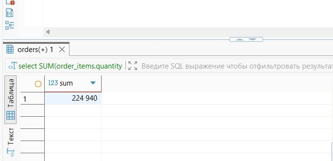
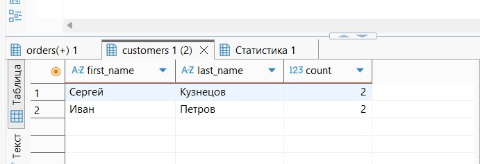
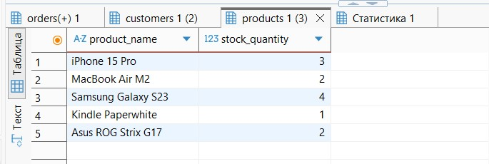
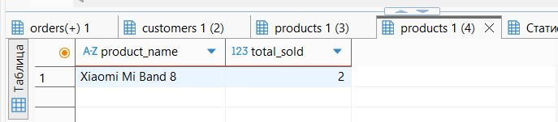
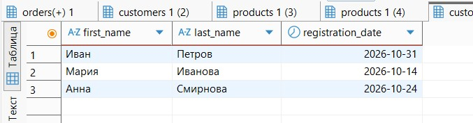
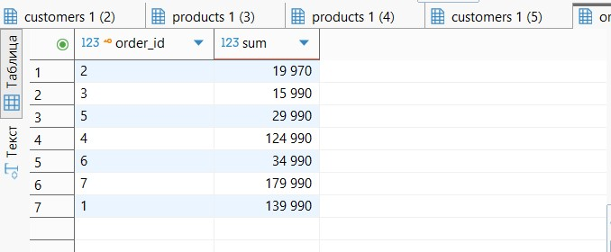
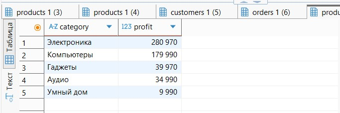

Цель запроса 1: найти общую сумму всех завершенных заказов. 
В результате запрос вывел общую сумму, которая составляла 224 940.

Бизнес-контекст: цифра показала выручку, которую компания получила от всех успешно завершенных заказов.
Использование: Компания может сравнивать выручку с прошлыми периодами, смотреть рост или её падение.
Примечание по оформлению: в запросах я использую полные названия таблиц, а не короткие (o, c, oi). Я сделала это для того чтобы лучше понимать структуру и потому что с короткими названиями сильно путалась. В дальнейшем буду стараться делать код более читаемым. 

Цель запроса 2: найти клиентов с наибольшим количеством заказов. В результате вышло 2 человека, у каждого по 2 заказа.

Бизнес-контекст: это позволяет компании увидеть клиентов, которые делают заказы несколько раз, значит им нравится сервис.
Использование: компания может выделять таким клиентам бонусы или персональные скидки за большее количество заказов.

Цель запроса 3: найти товары, которых осталось на складе меньше 5 штук. В результате на складе оказалось 5 товаров в количестве меньше 5 штук. 

Бизнес-контекст: это позволяет компании посмотреть товары, которых осталось мало.
Использование: компания видит товары, которые нужно заказать.

Цель запроса 4: найти самый популярный проданный товар. Результат показал, что это часы. 

Бизнес-контекст: компания может увидеть самый продаваемый товар.
Использование: если он часто продается, то нужно следить, чтобы он был в наличии. Можно использовать этот товар как маркетинговый ход (использовать на акциях, может каких-то розыгрышах)
Оптимизация: у меня здесь группировка идет по product_name, а если окажется так. что у товаров два одинаковых названия. Наверное лучше использовать группировку по id.

Цель запроса 5: увидеть клиентов, которые зарегестрировались за последний месяц. Результат показал троих человек.

Бизнес-контекст: компания видит количество новых клиентов.
Использование: можно использовать для сравнения (приход клиента по месяцам), вохможно отправлять различные рассылки с промокодами для новых клиентов.

Цель запроса 6: увидеть заказы общей стоимостью 10 000 руб. В результате таких заказов оказалось 7. 

Бизнес-контекст: запрос помогает увидеть заказы с высоким чеком 
Использование: таким клиентам можно предложить персональные скидки или какую-то бонусную карту.
Оптимизация: возможно можно было сначала сумму посчитать, а потом фильтровать. Как я понимаю, результат тот же останется.

Цель запроса 7: выявить категории товаров, приносящие наибольшую выручку. Результат показал нам 5 категорий.

Бизнес-контекст: компания видит наиболее ходовые категории, соответственно на них нужно направлять больше ресурсов.
Использование: У нас в результате самые ходовые категории это электроника и компьютеры, значит при планировании бюджета на них нужно отложить больше ресурсов.